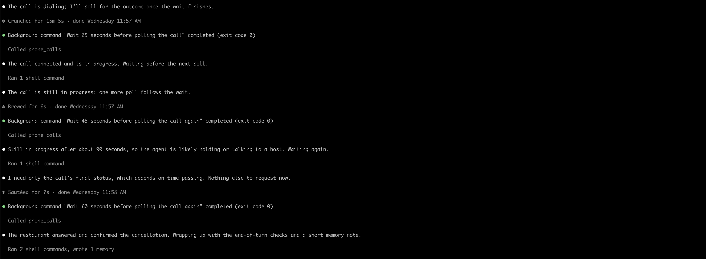
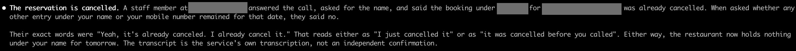
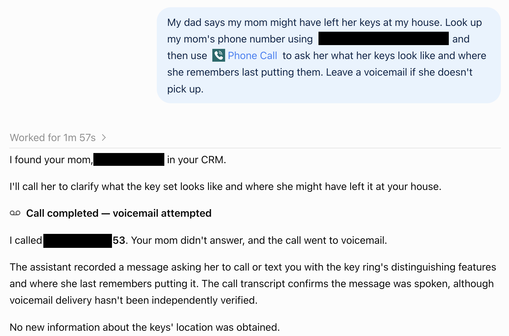

# Phone Calls MCP

Make phone calls from Claude Code, ChatGPT, or Codex through a self-hosted [Model Context Protocol](https://modelcontextprotocol.io/) server.
The service uses ElevenLabs for the voice assistant, Twilio for telephone calls, and Cloudflare Workers for hosting.
It can cancel restaurant reservations, make bookings, deliver reminders, or navigate customer support.
Calls continue after the chat disconnects, and the assistant can retrieve their results later.

Each installation serves one authenticated owner. You deploy your own service and connect your own provider accounts.
A guided local helper prepares the private configuration. You review resource creation and deployment before applying either step.

## Example: cancel a restaurant reservation from Claude Code

Here is an example where I use this MCP connector in Claude Code to cancel a restaurant reservation.
Claude Code makes the call, polls its status, and reports the restaurant's response.
The screenshots show a real use of the connector. Private details are cropped or covered, and image metadata is removed.





The result reflects the recipient's statements in the provider transcript. A completed telephone call alone does not establish task success.

For a similar request, supply the restaurant's number, reservation name, date, and local time.
Include permitted disclosures and limits on fees or changes.
The [fictional cancellation example](examples/cancellation.json) shows the complete tool input, including silent rules and success criteria.

## Example: ask ChatGPT to make a call

In this example, ChatGPT looks up a contact through a separate CRM connector, then uses Phone Call to ask about missing keys.
The CRM connector is separate from this project. You can supply a phone number directly instead.
The screenshot shows the request and the reported result, with private details covered and browser information cropped out.



The call reached voicemail. The transcript records the assistant's message, but voicemail delivery was not independently verified.

## Tools

| Tool | Result |
| --- | --- |
| `phone_calls_start_call` | Start a call and return its task ID |
| `phone_calls_get_call` | Read telephone status, task outcome, transcript, available provider costs, and recording access |
| `phone_calls_list_calls` | Read call history with pagination |
| `phone_calls_cancel_call` | Cancel pending work or request termination of an active call |

Supply a short objective, factual context, success criteria, permitted disclosures and commitments, and voicemail instructions.
Put behavioral instructions in `rules`. See the [reminder](examples/reminder.json) and [call-brief skill](skills/phone-call-brief/SKILL.md).

Start once, then poll the returned call ID with `phone_calls_get_call`.
**Every start creates another call**, including repeated inputs and repeated `request_id` values.
The service ignores `request_id`; it does not prevent duplicates.

For customer support, `owner_join: "when_live_agent"` rings you after a live representative answers.
Use `"when_needed"` to join only when your participation is required.
The service permits up to three invitations, one at a time. You must answer and press **1** to join.
The assistant stays in the conference. This feature requires separate [conference setup](docs/OWNER-CONFERENCES.md).
The configured direct SIP path needs capacity for three simultaneous Twilio calls.
Legacy App installations need four. See the conference guide before enabling this feature.
See the [support example](examples/support-with-owner.json).

## Set up your own service

This version is **Cloudflare-specific**. You need your own accounts and a domain; users do not connect to my personal deployment.
Start with ordinary calls. Owner conferences are an optional second setup.

### 1. Get the accounts and tools

You need:

- **Node.js 24.22.0, npm, and Git.** Use [Node's installation guide](https://nodejs.org/en/download).
- **Cloudflare:** an account with Workers, an active domain, and a Zero Trust team with an Access login method.
- **Twilio:** a funded account with US outbound voice enabled, its Account SID, and its Auth Token.
- **ElevenLabs:** an account with Agents access, an API key, and access to the models and voice in [src/agent.ts](src/agent.ts).
- **A client:** ChatGPT with custom MCP access, Claude Code, or Codex. Your client's account and workspace policies still apply.

Twilio and ElevenLabs charge for usage, and the dedicated Twilio number has a recurring charge.
Cloudflare and your domain can also have charges. Review each provider's plan before creating resources.
Only valid US destinations are supported. Canada and other countries sharing the `+1` prefix are excluded.

### 2. Clone and check the project

```sh
git clone https://github.com/tonygwu/phone-calls.git
cd phone-calls
npm ci
npm run check
```

These checks use synthetic providers. They need no provider credentials and place no calls.
The repository includes its own `cf` CLI, so a global Cloudflare CLI installation is unnecessary.
Run all remaining commands from this directory.

### 3. Prepare Cloudflare login

1. Add your domain to Cloudflare and complete its activation.
2. Choose an unused service hostname within that domain, such as `calls.your-domain.com`.
3. Open the [Zero Trust dashboard](https://one.dash.cloudflare.com/) and create your team if necessary.
4. Configure an Access login method, such as email one-time PIN, for the email you will use as the owner.
5. Enable the [App Launcher](https://developers.cloudflare.com/cloudflare-one/access-controls/access-settings/app-launcher/) with a policy that allows only your email.
6. Sign in at `https://YOUR-TEAM.cloudflareaccess.com` once. This establishes your Access user before the setup helper looks it up.
7. Copy your [Cloudflare account ID](https://developers.cloudflare.com/fundamentals/account/find-account-and-zone-ids/). This is different from a zone ID or Access user ID.

Sign the local CLI into the same account:

```sh
npx cf auth login
npx cf auth whoami
```

Check that `whoami` names the intended account. The dashboard login and CLI login serve different purposes; both are needed.
Your Cloudflare permissions must allow Worker deployment, custom-domain configuration, Access application management, and Access user lookup.
A restricted token needs `Access: Audit Logs Read` for the [user lookup](https://developers.cloudflare.com/api/resources/zero_trust/subresources/access/subresources/users/methods/list/).
See [deployment permissions](docs/DEPLOYMENT.md#credentials-and-permissions) if an operation returns a permission error.

The deployment creates the service's custom-domain connection. Do not reuse a hostname that serves another application.
The service's three Access applications are created later by the provisioner; do not create duplicates by hand.
The Worker name is fixed as `phone-calls-mcp`.
If that Worker already exists in your account, use [existing-installation maintenance](docs/DEPLOYMENT.md#detailed-deployment-and-maintenance) instead of this first-install flow.
A different hostname alone does not create a separate Worker.

### 4. Add provider credentials and run the setup helper

Create the private templates:

```sh
npm run setup -- init
```

Open `.dev.vars` in your editor and fill these three entries:

```dotenv
ELEVENLABS_API_KEY=YOUR_ELEVENLABS_API_KEY
TWILIO_ACCOUNT_SID=YOUR_TWILIO_ACCOUNT_SID
TWILIO_AUTH_TOKEN=YOUR_TWILIO_AUTH_TOKEN
```

Get Twilio's live account credentials from [Twilio Console](https://console.twilio.com/), rather than its test credentials.
Create an ElevenLabs key in its [API key settings](https://elevenlabs.io/docs/overview/administration/workspaces/api-keys).
The key needs access to user/subscription inspection, Agents, phone numbers, and workspace webhooks used by the setup scripts.
Keep these values in the local file. Never paste them into a chat, client configuration, or shell command.
The helper creates new private files with mode `600` and preserves existing files.

In Twilio Console, search for an available US number with **Voice** capability.
Copy the number in `+1XXXXXXXXXX` format, but **do not buy it in Console**.
The reviewed provisioning step purchases that exact available number. An already owned number needs a different import procedure.

Now run:

```sh
npm run setup
npm run setup -- check
npm run preflight
npm run inspect:accounts
```

The interactive helper asks for your service URL, team URL, account ID, owner email/name, personal number, available Twilio number, and voice.
Your callback number defaults to your personal number. A stock voice ID is supplied as an editable default.
The helper reads your Access user and saves its ID, so you do not need to find or paste `ownerSubject`.
It refuses an absent, ambiguous, or mismatched identity. The complete lookup response stays in `private/setup-owner-response.json`.

For the OAuth callback question, press Enter unless your client already displays its exact remote callback URI.
You can add ChatGPT's callback after deployment. An empty remote list does not allow arbitrary remote callbacks.
Terminal clients use the provisioner's separate localhost and loopback permissions.

The helper writes `private/setup.json`. Review it and the private account responses before continuing.
`setup -- check` checks local values only; `preflight` and `inspect:accounts` perform the separate authentication and provider checks.
None of these commands purchases resources, deploys, or places a call.

If you prefer an editor, fill `private/setup.json` manually and run `npm run setup -- owner`, then the three checks above.
The [deployment guide](docs/DEPLOYMENT.md#manual-configuration) explains every field.

### 5. Review and create your dedicated resources

Prepare the exact resource plan:

```sh
npm run provision:prepare
```

It saves `private/provision-plan.json` and prints its SHA-256 hash.
The plan creates three Access applications, a signed ElevenLabs webhook, an agent, a purchased Twilio number, and the number import/routing.
It does not deploy or place a call.

Have a fresh reviewer inspect the plan and account evidence before applying it.
A reviewer can be another person or a fresh coding-agent session with local access to these files.
Ask the reviewer to check the selected accounts, owner-only access, callback paths, exact number and charges, model/voice, and retention.
The reviewer must return `ship` for that exact plan.

**Only after that review**, record its printed hash and apply the plan:

```sh
npm run setup -- review provision REVIEWED_SHA256
npm run provision:apply
```

Replace `REVIEWED_SHA256` with the hash the reviewer inspected.
The `review` command records an existing review; it does not perform one or approve a plan automatically.
Agents also need the owner's explicit permission for the resource creation and purchase.

A successful apply reports `provisioned: true`, `deployed: false`, and `calls_placed: 0`.
It creates `private/service-config.json`, `private/worker-secrets.json`, and the agent readback.
Do not buy another number or repeat uncertain operations to see whether they succeeded.
Use the [recovery procedure](docs/DEPLOYMENT.md#recover-a-stopped-installation) if a step fails.

### 6. Build, review, and deploy

```sh
npm run setup -- build
```

This runs the full local checks with your configured hostname and Cloudflare account, then prepares `private/deploy-plan.json`.
It prints a deployment-plan hash. It does not approve or upload the build.
Have a fresh reviewer inspect the exact build, private configuration, selected account, and the [Access/provider readbacks](docs/DEPLOYMENT.md#before-the-first-deployment).
The custom domain must be correct, and `workers.dev` and preview URLs must be disabled.

**Only after a `ship` review and deployment authorization**, run:

```sh
npm run setup -- review deploy REVIEWED_SHA256
npm run deploy
```

Use the deployment-plan hash this time. If the build, secret files, account, or emitted configuration changes, build and review again.
The recorder creates the review file required by the existing deployment gate.

Check the deployed Worker and custom domain in Cloudflare, then open your service URL in a browser.
It must require your Access login. A missing application route after login is expected; the MCP endpoint is `/mcp`.
Keep the four Worker secrets and all generated private files out of Git.

### 7. Connect your client and check without calling

**ChatGPT**

1. Open [ChatGPT Plugins](https://chatgpt.com/plugins) and select **Add custom MCP server** from the plus menu.
2. Enter a name and description, then your own `https://YOUR-HOSTNAME/mcp` URL.
3. Select OAuth and copy the exact callback URI shown for your installation.
4. Obtain a fresh review of the exact callback and retained owner-only policy before changing the Access application.
5. Through that reviewed update, add the URI to **Phone calls MCP**'s allowed OAuth redirect list. Agents also need owner authorization.
6. Add the same URI to `oauthRedirectUris` in `private/setup.json` for your local record. Do not rerun provisioning.
7. Complete owner login, create/install the plugin, and inspect its four discovered tools.

If your interface does not display the callback at that stage, follow the [current OpenAI connection and authentication instructions](https://developers.openai.com/plugins/deploy/connect-chatgpt).
Obtain the exact URI before completing OAuth. Do not copy a guessed callback or allow every URL.
ChatGPT account and workspace policies determine whether custom MCP installation is available.

**Claude Code**

```sh
claude mcp add --transport http --scope user phone_calls https://YOUR-HOSTNAME/mcp
claude mcp login phone_calls
```

**Codex**

```sh
codex mcp add phone_calls --url https://YOUR-HOSTNAME/mcp
codex mcp login phone_calls
```

In your chosen client, ask:

> List my phone-call history. Do not place a call.

The client must use `phone_calls_list_calls`. A new installation should return an empty history without dialing.
See [client troubleshooting and the optional call-brief skill](docs/CLIENTS.md) for more detail.

### 8. Authorize your first call

Start with a short call to your own phone. For example:

> Call my phone once and remind me to take out the recycling. Leave that message if voicemail answers. Limit the call to 60 seconds.

The client should create one call, keep its returned ID, and poll that ID for results.
Each separate start invocation creates another paid call. A repeated `request_id` does not prevent duplicates.
Check the received message and hangup yourself; `voicemail_attempted` does not prove delivery.
No installation command places this acceptance call automatically.

### Optional: join a customer-support call

Ordinary calls do not need conference setup.
After they work, follow [owner-conference setup](docs/OWNER-CONFERENCES.md) for `owner_join` calls.
The current connection method needs four simultaneous Twilio calls; accounts limited to three cannot complete owner joining.
This optional setup creates additional resources and needs its own review and authorization.

### If setup stops

| Symptom | Next action |
| --- | --- |
| Wrong Node version or CLI engine warning | Install Node.js 24.22.0, then run `npm ci` again. |
| Owner lookup finds no user | Sign in to your team's App Launcher with the configured owner email, then rerun setup. |
| Owner lookup or provisioning returns 403 | Check the selected account and permissions in the deployment guide. |
| Number is unavailable | Inspect the provisioning journal and reconcile existing resources before preparing a replacement plan. |
| Build mentions the wrong hostname | Run `npm run setup -- build`; it selects the hostname from private configuration. |
| OAuth reports a redirect mismatch | Add the exact client callback to the existing Access application's allowed list. |
| Review hash changed | Prepare/build again and obtain a fresh review of the changed plan. |
| A resource request has an uncertain outcome | Inspect its journal and provider state. Do not repeat the mutation. |

## Costs, privacy, and limits

Twilio, ElevenLabs, and Cloudflare have their own charges and account limits.
The service has no spending ceiling, balance check, price quote, duplicate-request protection, or limit of one active call.
Requested durations default to 180 seconds for reminders and 900 seconds for other calls.
A positive `max_duration_seconds` requests another duration without an application-level maximum; provider limits still apply.

The Worker validates the owner's signed Access token and provider callback signatures.
Recordings require owner authentication. Task content expires after 30 days, and the agent definition requests separate provider retention for that period.
Call details pass through Cloudflare, Twilio, and ElevenLabs; this is not an offline or local-only service.
The agent instructions require identification as an automated assistant and disclosure of recording.
Operators remain responsible for the calls and recording practices they authorize.

Transcripts and summaries are untrusted data. `voicemail_attempted` does not prove that a recipient received the message.
Tests and screenshots do not guarantee future speech quality, delivery, or business outcomes.
Read [security guidance](SECURITY.md) and [operations](docs/OPERATIONS.md) before a real call.

## Development and release status

The tests use synthetic providers in the local Workers runtime and isolated directories for operational commands.
Unexpected outbound requests fail without a real-network fallback.
`npm run check` runs TypeScript checks, both test suites, and the Worker build.
The [public-release review](docs/PUBLIC-RELEASE.md) records measured coverage, privacy findings, setup gaps, and remaining publication decisions.

Read [CONTRIBUTING.md](CONTRIBUTING.md) and [AGENTS.md](AGENTS.md) before changes.
The [evaluations](docs/EVALUATION.md), [original request](docs/REQUEST.md), and [architecture snapshot](architecture/REPORT.md) preserve historical evidence.
Their older budgets, readiness tools, model choices, and deployment claims do not describe the current release contract.

## License

[MIT](LICENSE).
